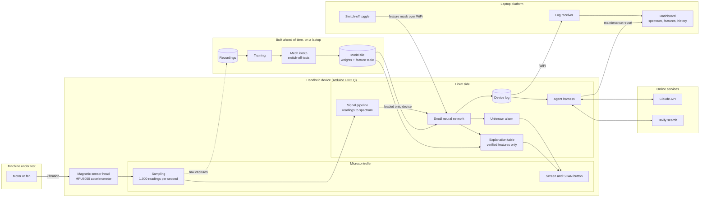
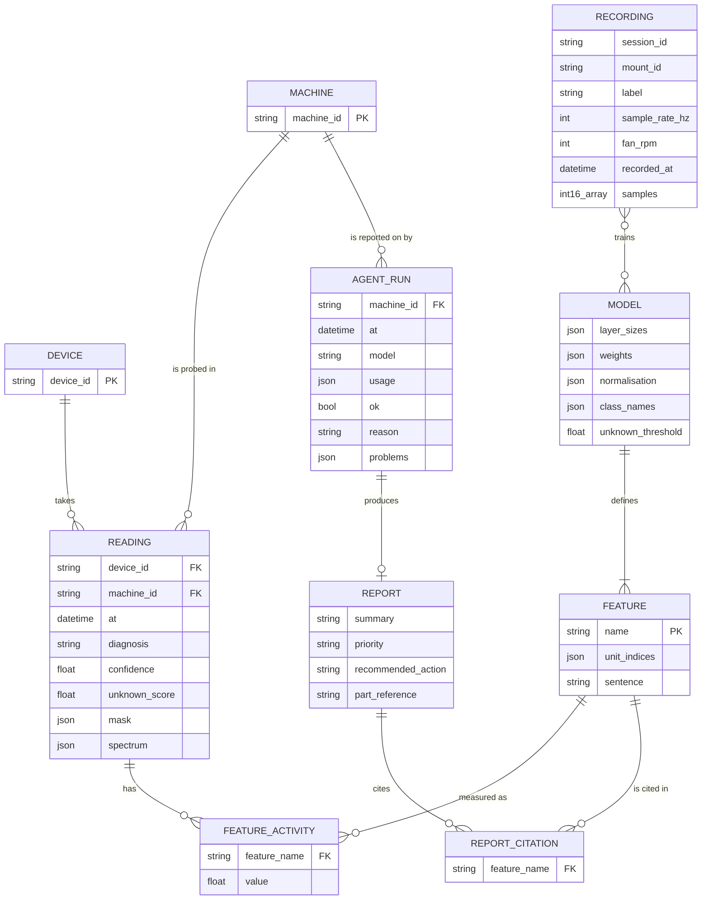

# Architecture

Two diagrams: how the system fits together, and the data it keeps. Details are in the [TRD](TRD.md).

## High-level design

Reading it left to right:

1. **Sense.** The magnetic head sits on the machine. The microcontroller samples it on a steady clock.
2. **Decide.** The signal pipeline turns readings into a spectrum, the network diagnoses, the unknown alarm checks whether the pattern is familiar, and the explanation table supplies the reason. The result goes to the screen. None of this needs a network.
3. **Share.** Each reading is logged and uploaded over WiFi to the laptop, where the dashboard shows it.
4. **Act.** The agent reads the log, calls Claude and Tavily, and produces a maintenance report. This is the only part that needs the internet.
5. **Prove.** The switch-off toggle sends a feature mask back to the device, and the diagnosis changes live.

The bottom box happens before any of that: recordings train the network, mech interp finds and tests its features, and the result is one model file loaded onto the device. The same signal pipeline code runs in training and on the device.

The dotted line is the bootstrap: the device captures the raw recordings used for training.

Tracks map onto the boxes: track 1 is the handheld, track 2 is recordings and the signal pipeline, track 3 is training, mech interp and the explanation table, track 5 is the laptop platform and the agent.

## Data model

Reading it:

- **Recording** is training data: a labelled capture from the rig. **Reading** is what the device produces in use: one diagnosis per window.
- **Feature** is the centre of the design. Features come from the model, show up as activity in each reading, and are the only things a report may cite.
- **Agent run** is one attempt to write a report. It has a report only if the checks passed.

In storage these are files, not database tables. Recordings are `.npz` files. The model and its features are one JSON file. Readings and agent runs are one JSON object per line. Feature activity and citations live inside their parent records.

## Known gaps in the formats

1. **Readings do not record which model produced them.** After a retrain, old and new diagnoses cannot be told apart, and a feature name may mean something different. Add a model version to the model file and to each reading. Fix before recording real data.
2. **Recordings have no machine ID.** Fine with one demo fan, a problem with two.
3. **Machines and devices are only IDs.** There is nowhere to store a machine's name, location or rotation speed.
