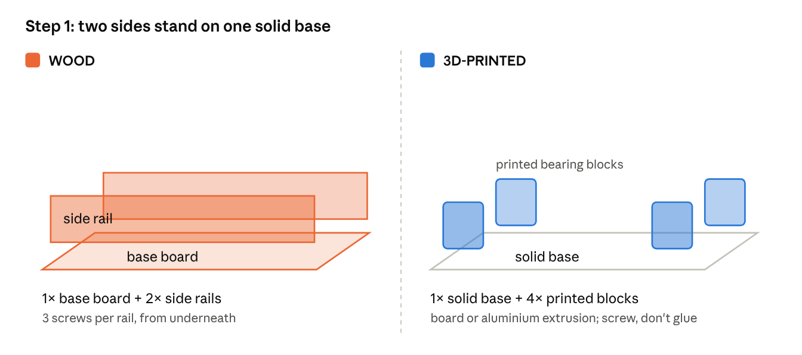
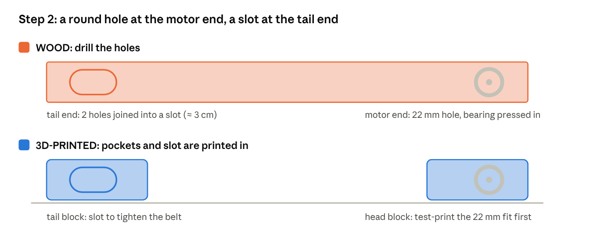
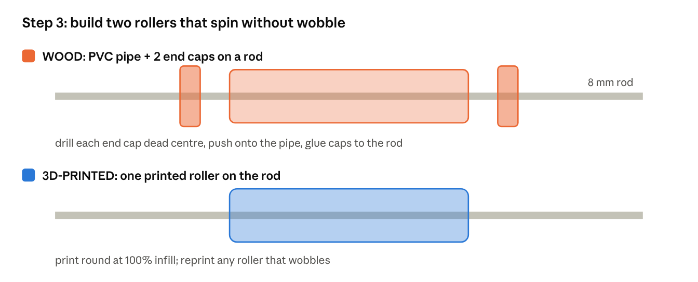
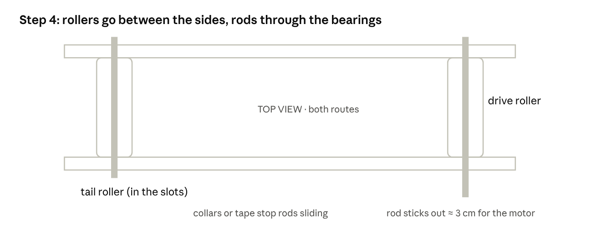
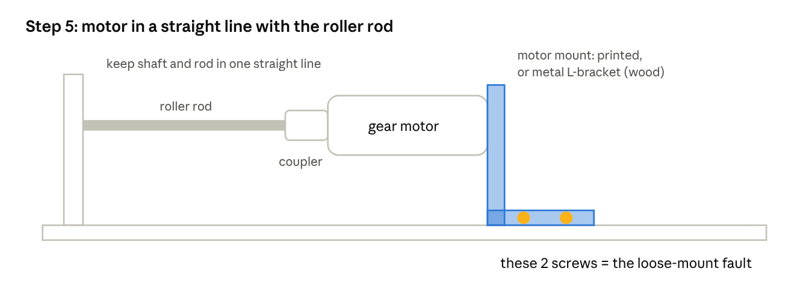
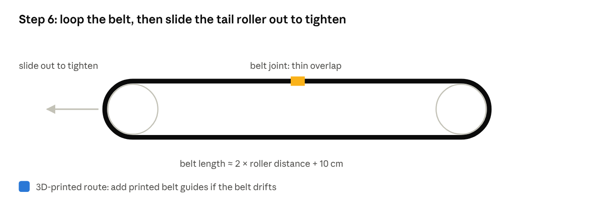
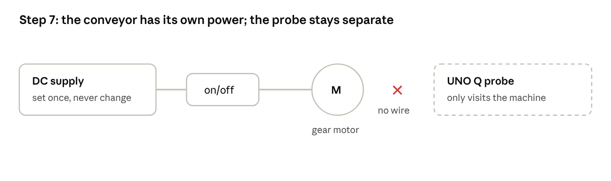
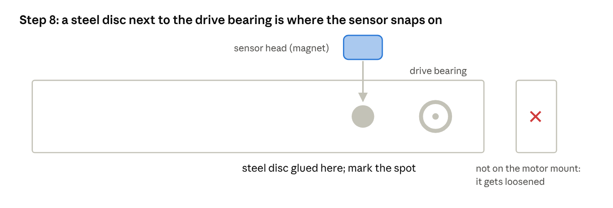
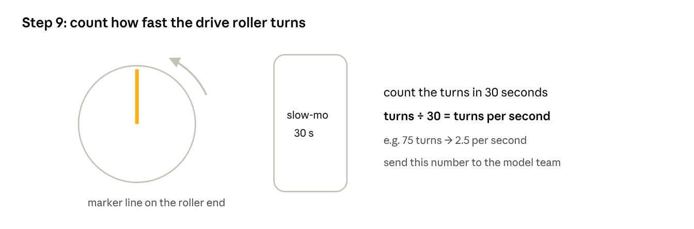
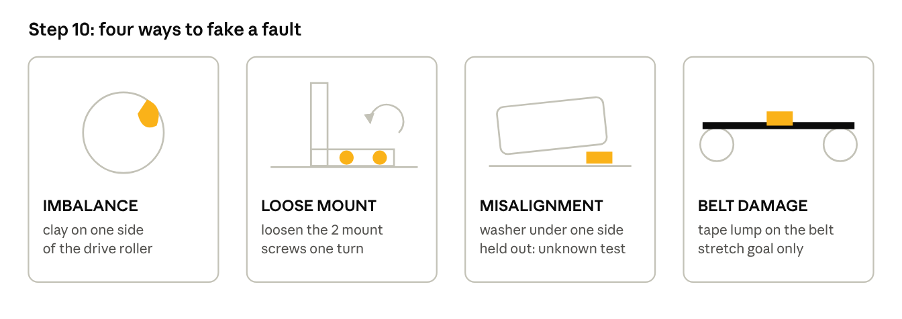

# Mini conveyor build guide

> The drawings live in the repo-root `images/` folder.

A desk-size belt conveyor to act as the demo machine for effente. The handheld probe (Arduino UNO Q + MPU-6500 sensor head) is built separately, following the repo. This guide covers only the conveyor.

A printed version sized for the team's TT gear motor (direct drive, printed pin bushings, no bearings or rods) is in [device/cad/](../../device/cad/README.md), with print-ready STL files.

## Printed kit (device/cad): quick build

This is what the team is building. It replaces steps 1 to 6 below; then carry on from step 7.

1. Print the parts listed in the CAD README. Print the drive roller first and check it pushes snugly onto the TT motor's output shaft.
2. Put a dab of grease on the roller pins.
3. Fit the TT motor in the bracket with its output shaft pointing at the frame, and hold it with 2 zip ties through the bracket's tunnels.
4. Bolt the bracket to the pad on the frame with 2 M3 bolts, nuts in the traps underneath. These bolts are the loose-mount fault.
5. Push the drive roller onto the motor shaft through the slot in the wall; its far pin drops into the slot in the other wall.
6. Loop the belt over both rollers, then drop the idle roller's pins into its slots.
7. Glue a magnetic steel disc into the pocket on the outside of the wall opposite the motor. That is the probe point.
8. Stand the frame on a rubber mat or tape it to the table.

Sizes in the CAD for the TT motor are listing values, not measurements: measure the motor first.

## Colour key

| Marker | Route |
|---|---|
| 🟫 | **Wood route**: frame and rollers from wood and PVC |
| 🟦 | **3D-printed route**: printed parts on a solid base |
| ⬜ | **Both routes**: same for either |

Pick one route and follow its colour. Sizes are a guide: measure your actual parts with calipers first.

In the drawings: orange = wood, blue = 3D-printed, grey = both routes, yellow = a fault or the parts that cause one.

---

## Why a solid base either way

A fully printed frame is usually bigger than the print bed (often 22–25 cm), has to be joined in pieces, flexes, and adds vibration of its own. That makes "loose mount" hard to tell from a wobbly frame. So the 🟦 route prints the detailed parts and bolts them to a solid base.

---

## Parts list

| Route | Qty | Part | Notes |
|---|---|---|---|
| 🟫 | 1 | Wood base board, about 45 × 15 cm, 1–2 cm thick | Plywood or pine |
| 🟫 | 2 | Wood side rails, about 45 × 6 cm, 1.5–2 cm thick | Hold the bearings |
| 🟫 | 2 + 4 | PVC pipe (about 32 mm wide, 10 cm long) + end caps | The rollers |
| 🟫 | 1 | L-bracket | Motor mount |
| 🟦 | 1 | Solid base: wood board or aluminium extrusion (e.g. 2020 profile), about 45 cm | Keeps loose mount repeatable |
| 🟦 | 2 | Printed side plates / bearing blocks | 22 mm bearing pockets, tension slot at the tail end |
| 🟦 | 2 | Printed rollers | About 32 mm wide, 10 cm long, 8 mm centre hole or bearing pockets |
| 🟦 | 1 | Printed motor mount bracket | Held by 2 screws |
| 🟦 | — | Printed belt guides (optional) | Stop the belt drifting |
| 🟦 | — | PETG filament | PLA softens at about 50–70 °C |
| ⬜ | 4 | 608 skateboard bearings (22 mm outside, 8 mm hole) | Two per roller |
| ⬜ | 2 | 8 mm steel rod, about 20 cm (or M8 bolts) | Roller axles |
| ⬜ | 1 | Belt: rubber strip or resistance band, about 9 cm wide | Joined into a loop |
| ⬜ | 1 + spare | DC gear motor, 6–12 V, about 100–300 rpm | Note its shaft size |
| ⬜ | 1 | Shaft coupler (motor shaft → 8 mm) | Motor to drive roller |
| ⬜ | 2 | Screws for the motor mount | **These become the loose-mount fault** |
| ⬜ | 2–4 | 8 mm shaft collars, or tape | Stop rollers sliding sideways |
| ⬜ | ~10 | Wood screws | Frame |
| ⬜ | 1 | Regulated DC supply matching the motor (e.g. 9 or 12 V, 1 A+), or an adjustable buck converter + adapter | One fixed speed for every recording |
| ⬜ | 1 | On/off switch + wires | |
| ⬜ | — | Fault kit: modelling clay, coins, washers, duct tape, rubber mat | Step 10 |

### Tools

| Route | Tool |
|---|---|
| 🟫 | Drill with 22 mm (7/8") spade or Forstner bit, 8 mm bit, saw |
| 🟦 | 3D printer |
| ⬜ | Screwdriver, hot glue or epoxy, ruler, marker, calipers, phone with slow-motion video |

**Shortcut:** a ready-made hobby conveyor kit replaces steps 1–6. Start at step 7.

---

## Step 1: Frame

🟫 **Wood**
1. Stand the two side rails on the base board, parallel, along the long edges.
2. Leave a gap so a 10 cm roller fits with about 5 mm spare on each side.
3. Screw each rail to the base from underneath (3 screws per rail).

🟦 **3D-printed**
1. Use a wood board or aluminium extrusion as the base.
2. Screw the printed side plates or bearing blocks onto it, parallel, with the same roller gap.
3. Use screws, not glue, so the frame is stiff and parts can be swapped.

⬜ **Check:** the sides are parallel and don't wobble when pushed.

## Step 2: Bearing holes

🟫 **Wood**
1. Clamp both rails together and mark both ends so the holes line up.
2. **Head (motor) end:** drill a 22 mm hole, 2–3 cm from the end.
3. **Tail end:** drill two overlapping 22 mm holes about 3 cm apart and clean them into a slot, so the tail roller can slide to tighten the belt.
4. Press a bearing into each head-end hole (a drop of glue if loose).

🟦 **3D-printed**
1. **Print a test ring** with one 22 mm pocket first. Adjust the hole until the bearing presses in snugly.
2. Print the real plates at 100% infill, with the tail slot built in.
3. Press the bearings into the pockets. No drilling.

⬜ **Check:** an 8 mm rod passes through both head bearings and spins freely.

## Step 3: Rollers

🟫 **Wood**
1. Drill an 8 mm hole exactly in the centre of each end cap.
2. Push the caps onto the pipe, slide the rod through, centre the roller.
3. Glue the caps to the rod so the roller turns with it.

🟦 **3D-printed**
1. Print each roller at 100% infill, round, with the centre hole exactly in the middle and no seam bump.
2. Fix it to the rod with a set screw or epoxy, or use printed bearing pockets.
3. Reprint any roller that wobbles.

⬜ Optional: one layer of tape around the drive roller for grip.

⬜ **Check:** spin each roller on its rod. It turns smoothly with no visible wobble. An off-centre roller creates imbalance before you add any fault.

## Step 4: Fit the rollers

⬜ **Both routes**
1. Slide the drive roller's rod through the head bearings, leaving about 3 cm out on the motor side.
2. Put bearings on the tail roller's rod and drop them into the tail slots.
3. Stop the head rod sliding with shaft collars or tape against each bearing.

⬜ **Check:** both rollers are level and parallel. The gap between them matches on both sides.

## Step 5: Motor mount

🟫 **Wood:** fix the motor to a metal L-bracket.

🟦 **3D-printed:** print the motor mount solid (100% infill) and fix the motor to it.

⬜ **Both routes**
1. Push the shaft coupler onto the motor shaft and the drive roller rod; tighten its grub screws.
2. Line the motor up so its shaft and the roller rod are in a straight line.
3. Screw the mount to the base with **2 screws**. These are the loose-mount fault later.

⬜ **Check:** turn the roller by hand. The motor turns smoothly, with no binding or bending at the coupler.

⬜ **Warning:** misalignment here creates vibration before any fault is added. Get it straight now.

## Step 6: Belt

⬜ **Both routes**
1. Cut the strip to about twice the roller distance plus 10 cm. Overlap the ends 2–3 cm and glue or stitch. Keep the joint thin.
2. Push the tail roller in, loop the belt over both rollers, then slide the tail roller out until the belt is firm.
3. Fix the tail bearings in place with a screw or wedge.
4. 🟦 Add printed belt guides if the belt drifts.

⬜ **Check:** run the motor briefly. The belt runs straight and doesn't slip.

## Step 7: Power (fixed speed)

⬜ **Both routes**
1. Connect the motor to its own regulated supply (or buck converter) through the on/off switch. For the TT motor in the printed kit: 5 V from a USB charger, or a TB6612FNG driver run by an Arduino Nano at one fixed PWM value.
2. Set the voltage once and never change it during recordings.
3. Keep the conveyor's motor **separate from the UNO Q**. The probe visits the machine; it does not power or control it.

⬜ **Check:** the belt runs at a steady speed for several minutes.

## Step 8: Probe point for the sensor head

⬜ **Both routes**
1. Glue a steel disc on the side (rail or plate) right next to the drive-roller bearing. The magnetic sensor head snaps onto it.
2. **Not on the motor mount:** it gets loosened in the demo, and the sensor must stay rigid.
3. Mark the spot and use it for every recording.

⬜ **Check:** snap the head on and tug the cable gently. The head doesn't move.

## Step 9: Measure the roller speed

⬜ **Both routes**
1. Draw a line on the end of the drive roller.
2. Film it in slow motion for 30 seconds and count the turns. Divide by 30 for turns per second.
3. Give the number to the model team. Imbalance shows at that frequency, misalignment at twice it.

## Step 10: Faults and recordings

| Route | Fault | How |
|---|---|---|
| ⬜ | **Imbalance** (material buildup) | Clay or coins on one side of the drive roller |
| ⬜ | **Loose mount** | Loosen the 2 motor-mount screws one turn |
| ⬜ | Misalignment (held out, for the "unknown" test) | Washer under one side of the motor |
| ⬜ | Belt damage (stretch only) | Lump of folded tape across the belt |

⬜ **Both routes**
1. Put the conveyor on a rubber mat on a solid table.
2. Follow the repo's recording protocol: several sessions per fault, sensor head removed and re-attached between sessions.
3. Undo each fault fully before the next one.
4. Make faults clearly visible. Subtle faults fail on stage.

⬜ **Rule:** record all training data on this finished rig. Change the frame afterwards and you record again.

---

## Troubleshooting

| Route | Problem | Fix |
|---|---|---|
| ⬜ | Belt slips | Slide the tail roller out more; tape on the drive roller for grip |
| ⬜ | Belt drifts sideways | Nudge one end of the tail roller until it tracks straight; 🟦 add belt guides |
| ⬜ | Healthy run vibrates a lot | Check motor-to-rod alignment (step 5) and roller wobble (step 3) |
| 🟦 | Bearing loose in printed pocket | Reprint slightly smaller, or a drop of glue |
| 🟦 | Bearing won't go in | Reprint slightly larger; don't force it and crack the part |
| 🟦 | Printed part flexes or buzzes | Reprint at 100% infill, thicker walls; screw it down at more points |

## Print time (🟦 only, rough)

- Rollers: a few hours each.
- Side plates, brackets: 1–3 hours each.
- Start early: bearing fits often need a second try.
