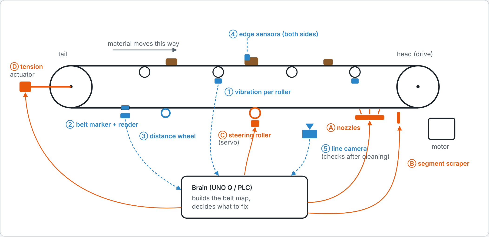
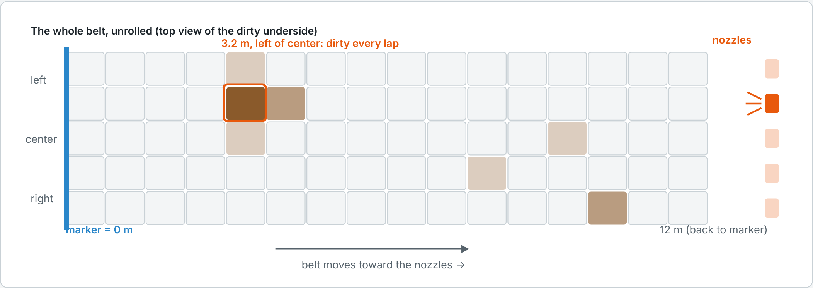
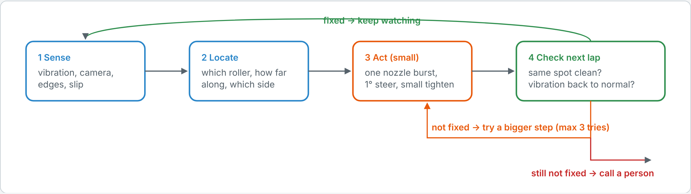
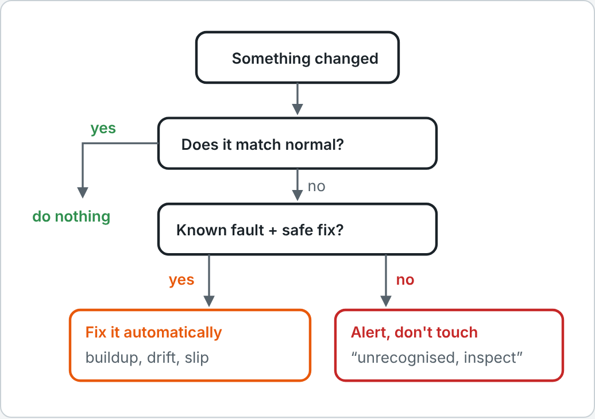
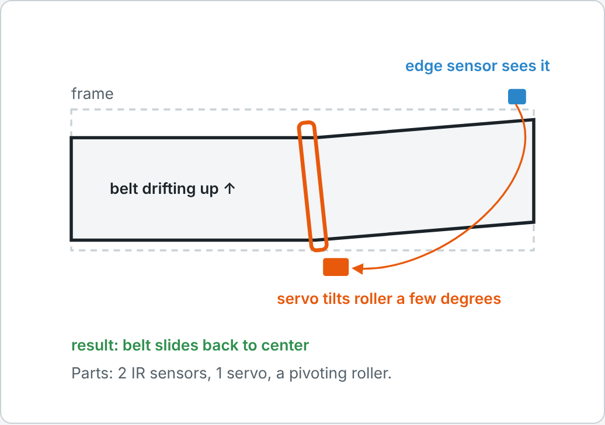

# Self-Adjusting Conveyor System

A conveyor that finds exactly where the dirt or drift is, fixes only that spot, then checks that the fix worked.

**Colour key:** 🟦 blue = sensor (finds the problem) · 🟧 orange = actuator (fixes it) · 🟫 brown = dirt / buildup · ⬛ black = belt and rollers

---

## 1. The whole system (side view)

### Sensors (find it) 🟦

| # | Part | What it tells you |
|---|---|---|
| ① | Vibration sensor on each roller | Which part is sick, and what kind of sick (buildup, worn bearing, loose). This is effente. |
| ② | Marker on the belt + reader | A magnet on the belt marks "0 m" every lap. |
| ③ | Distance wheel | Counts how far the belt has moved since the marker, so every spot has an address like "3.2 m past the marker". |
| ④ | Edge sensors (both sides) | How far each edge has drifted from center. |
| ⑤ | Line camera after the cleaner | Which side is dirty (left, center or right), and whether the cleaning worked. |

### Actuators (fix it) 🟧

| # | Part | What it does |
|---|---|---|
| Ⓐ | Nozzle row | Small air jets across the width. Only the one over the dirty spot fires. |
| Ⓑ | Segment scraper | A blade split into pieces, each pushed on separately, so it follows a worn, uneven belt. |
| Ⓒ | Steering roller (servo) | Tilts one return roller a few degrees to pull a drifting belt back to center. |
| Ⓓ | Tension actuator | Pulls the tail pulley back a little when the belt starts slipping. |

**Brain (UNO Q / PLC):** takes in all the sensor readings, builds the belt map, and decides what to fix.

---

## 2. How it knows exactly where: the belt map

- Picture the belt cut open and laid flat. The brain keeps a grid of it. Each square remembers how dirty it was last lap.
- The marker gives every square an address, so the brain knows when a dirty square will reach the nozzles. It fires only the nozzle above that square.
- If the same spot comes back dirty every lap, it's probably a damaged patch of belt, not loose dirt. The brain flags it for repair.
- The grid shown is example data, not real readings.

---

## 3. The loop: find, fix, check, and step up if needed

1. **Sense:** vibration, camera, edge sensors, slip.
2. **Locate:** which roller, how far along the belt, which side.
3. **Act (small):** one nozzle burst, a 1° steer, or a small tighten.
4. **Check next lap:** is the same spot clean? Is the vibration back to normal?
   - Fixed → keep watching.
   - Not fixed → try a bigger step (up to 3 tries).
   - Still not fixed → call a person.

---

## 4. Too many anomalies? The rule for acting alone

- **Matches normal** → do nothing.
- **A known fault with a safe fix** (buildup, drift, slip) → fix it automatically.
- **Anything unknown** → alert a person and don't touch it ("unrecognised, inspect").

You never need a list of every possible fault. The system learns what normal looks like, and anything different is either a fault it knows how to fix safely, or one it hands to a person.

---

## 5. Hackathon demo: the drift fix, seen from above

- **Parts:** 2 IR sensors, 1 servo, a pivoting roller.
- **Demo:** push the belt off center and watch it pull itself back.
- Pair it with effente's buildup detection for the vibration half of the story.

---

## Keep it honest

Each piece already exists in industry: self-training idlers, belt-tracking systems, smart scrapers like Flexco Elevate. What's new is joining them in one loop around a belt map, with a diagnosis that explains itself and a check after every fix. This is a design sketch. Nothing has been tested on a real line.
