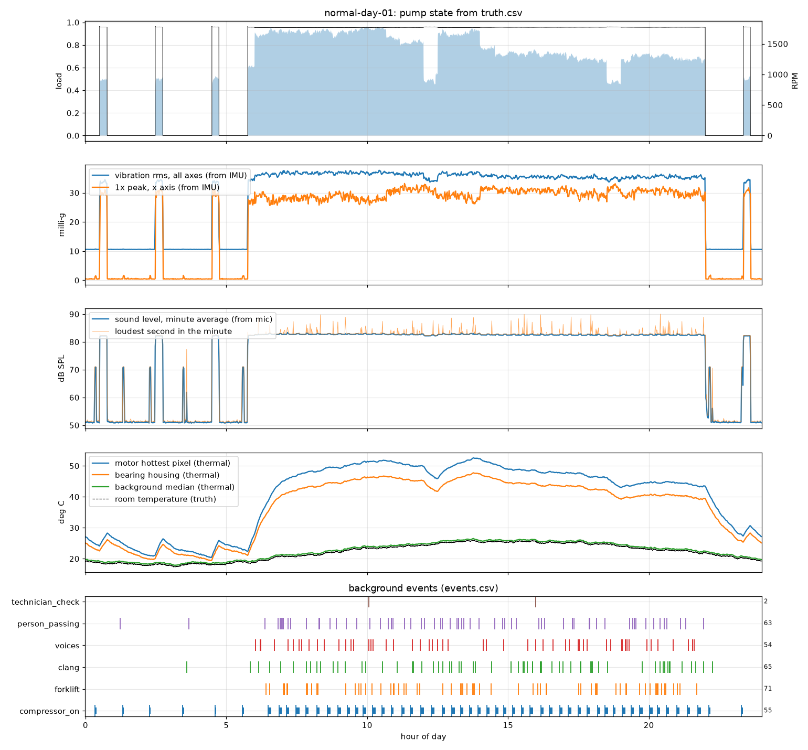

# Fake dataset: simulated normal day

**Everything in this folder is simulated, not recorded.** It is one day (00:00 to 24:00) of fake effente sensor data from a healthy factory pump. Use it to build and test the learn-normal model before real recordings exist.

It contains **normal operation only. There are no faults.**



## What types of fake data it has

### Sensor data

| Type | Fake sensor | Stored as | Rate |
|------|-------------|-----------|------|
| Vibration (3 axes) | MPU6050 accelerometer | `accel`, int16 counts, shape (N, 3), 16384 counts per g | 1 kHz |
| Rotation rate (3 axes) | MPU6050 gyroscope | `gyro`, int16 counts, shape (N, 3), 131 counts per °/s | 1 kHz |
| Sound (mono) | INMP441 microphone | `audio`, int16, shape (M,) | 16 kHz |
| Heat images | MLX90640 thermal camera, 55° lens | `thermal`, float32 °C, shape (F, 24, 32) | 4 frames per second |
| Timestamps | Microcontroller clock | `accel_t_us`, `audio_t_us` (one per 256-sample block), `thermal_t_us`, microseconds since midnight | — |

### Ground truth and labels

| Type | File | What it gives |
|------|------|---------------|
| Per-second truth | `truth.csv` | Machine state (`off`, `starting`, `running`, `stopping`), load, speed (Hz and RPM), motor current, room, motor surface, bearing and pump casing temperatures, compressor on or off, background noise level, and which events are happening |
| Event log | `events.csv` | Start and end of every event listed below |
| Description | `meta.json` | Machine, sensor settings, expected vibration frequencies, and a thermal label map saying which pixel is motor, pump, pipe, background and so on |
| Overall label | every `.npz` file | `label = "normal"` |

### Normal conditions covered

| Condition | Details |
|-----------|---------|
| Off | Overnight and between night runs |
| Start-up | 5 per day: direct-on-line start, 1.6 s to full speed, with an inrush hum |
| Coast-down | 5 per day: about 10 s from full speed to stop |
| Light load | Night top-up runs at 50 %, breaks at 55 % |
| Medium and heavy load | 60 % at start of day, 90 % first shift, 75 % second shift, with valve trims every 40 minutes or so |
| Warming and cooling | Motor 15 to 30 °C above the room, about 35 minutes to warm and 70 to cool |
| Room temperature swing | About 18 °C at night to 25 °C in the afternoon |
| Small speed changes | Speed falls slightly as load rises, and mains frequency wanders |

### Background events (all harmless)

| Event | Count in the day | Shows up in |
|-------|------------------|-------------|
| Air compressor cycling | 55 | Sound, and a small 24.6 Hz floor vibration |
| Forklift passing, many reversing with a beeper | 71 | Sound and floor vibration |
| Clang (dropped part by day, door at night) | 65 | Sound and a small vibration knock |
| People talking | 54 | Sound |
| Person walking past behind the machine | 63 | Thermal camera |
| Technician standing in front of the camera | 2 | Thermal camera and voices |

A good learn-normal model should accept all of these without an alarm.

### Not included

- **Faults** (imbalance, looseness, bearing wear, overheating). Adding a fault mode to the simulator is the next step.
- Room temperature and humidity from a BME280.
- MLX90640 chess-pattern artefacts, I2C read gaps or dropped samples.
- A check against a real pump. Levels are plausible, not measured.

## What is in the repo and what you rebuild

The full day is 5.6 GB in 24 files of about 233 MB each, which is over GitHub's 100 MB per-file limit. So the repo holds everything except the hour files, and you rebuild them in about 5 minutes. The generator is seeded, so the rebuilt files are identical to the originals.

| File | In the repo | Size |
|------|-------------|------|
| `normal-day-01/sample_0540-0550.npz` | Yes. A 10-minute excerpt of the raw data, from off through the morning start-up into running. | 39 MB |
| `normal-day-01/truth.csv`, `events.csv`, `meta.json` | Yes | 7 MB |
| `normal-day-01/per_minute.csv`, `overview.png`, `snapshot.png` | Yes. Minute-by-minute summary and plots from the checker. | 0.7 MB |
| `normal-day-01/hour_00.npz` … `hour_23.npz` | No, rebuild them (ignored by git) | 5.6 GB |

Rebuild and check the full day:

```bash
python3 -m effente.simulate_day --out fake-dataset/normal-day-01
```

```bash
python3 training/check_day.py fake-dataset/normal-day-01 --at 10:30
```

Needs Python 3 with NumPy, SciPy and Matplotlib. Use `--seed 2` (or any number) for a different day of the same machine.

## The machine

A factory cooling-water pump: a 7.5 kW, 4-pole induction motor on 60 Hz mains, driving a centrifugal pump with a 6-vane impeller at about 1,770 RPM.

| Time | What the pump does |
|------|--------------------|
| 00:30, 02:30, 04:30, 23:20 | 15-minute night top-up runs at half load |
| 05:45 | Start for production, 60 % load |
| 06:00 to 14:00 | First shift, 90 % load |
| 12:00 to 12:30 | Lunch, 55 % load |
| 14:00 to 22:00 | Second shift, 75 % load |
| 18:30 to 19:00 | Break, 55 % load |
| 22:00 | Stop |

Frequencies to expect at nominal speed: 1× 29.5 Hz, 2× 59 Hz, vane pass 177 Hz, motor hum 120 Hz and harmonics, cooling-fan blade pass 295 Hz, rotor-slot tone about 826 Hz, compressor 24.6 Hz, base-frame resonance 95 Hz.

## Sensor details

- **Accelerometer axes:** x radial horizontal, y along the shaft, z up. The data includes gravity, the chip's zero-g offsets, its temperature drift and its 260 Hz on-chip low-pass filter.
- **Microphone level:** firmware gain is +12 dB, so dB SPL = 20·log10(rms / 23170) + 120 − 12.
- **Thermal:** apparent temperature, not corrected for emissivity, so the bare steel pipe reads close to the room.
- **Clocks:** each sensor's clock is slightly off nominal, as real parts are. The accelerometer runs at 1002.1 Hz, the mic at 15,999.4 Hz and the camera at 3.982 Hz. Align sensors by timestamp, never by sample count.

Loading data:

```python
import numpy as np
r = np.load("fake-dataset/normal-day-01/sample_0540-0550.npz")
accel_g = r["accel"] / r["accel_lsb_per_g"]   # (N, 3)
t_accel = r["accel_t_us"] / 1e6                # seconds since midnight
frames = r["thermal"]                          # (F, 24, 32) deg C
```

## Suggested use

- Train the learn-normal model on 00:00 to 20:00, then test for false alarms on 20:00 to 24:00, which includes a stop, a coast-down and a night start-up.
- Check that start-ups, forklifts and technician checks do not raise alarms.

Made by [effente/simulate_day.py](../effente/simulate_day.py) and checked by [training/check_day.py](../training/check_day.py).
